# Helios SF32

Helios SF32 is smartwatch firmware for SiFli SF32 boards. It uses the SiFli SDK, which is based on the RT-Thread IoT real-time operating system. Helios SF32 brings a touchscreen interface, Bluetooth phone sync, and switchable watchfaces to the LCD devkit and the DIY SFWatch.

Build instructions and integration notes are in the [firmware guide](docs/FIRMWARE.md).

## Boards

- **SiFli LCD DevKit** is the development board for getting started with Helios. [Board setup](docs/BOARD_SETUP.md)
- **DIY SFWatch v1.0** is a custom watch with a 466×466 AMOLED touchscreen and a motion sensor for step counting and raise to wake. [Hardware details](docs/SFWATCH_V1_0.md)

## Images

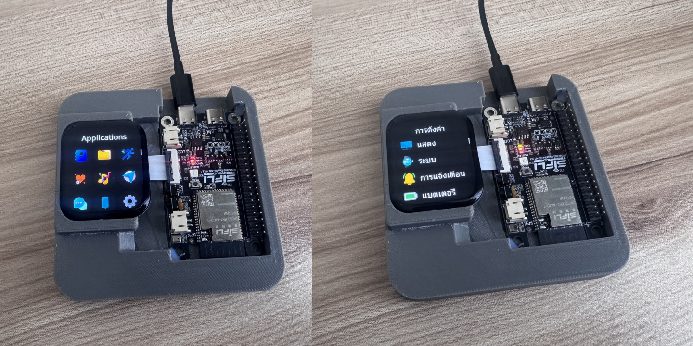
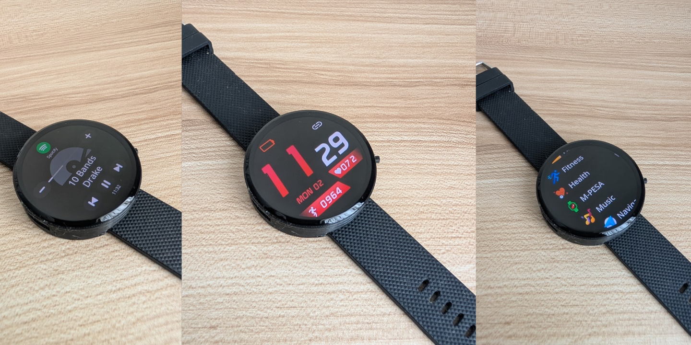

## Features

- Chronos phone sync for notifications, weather, contacts, and navigation.
- iPhone notifications and music controls over Bluetooth
- Stopwatch and countdown timer
- Phone-synced alarms on boards with a buzzer
- Heart rate and SpO₂ on the LCD DevKit with a MAX30100 sensor
- Step counting, raise to wake, and wrist gestures on SFWatch

## Helios UI

The touchscreen interface is built with LVGL and maintained in the [Helios UI repository](https://github.com/fbiego/helios_ui).

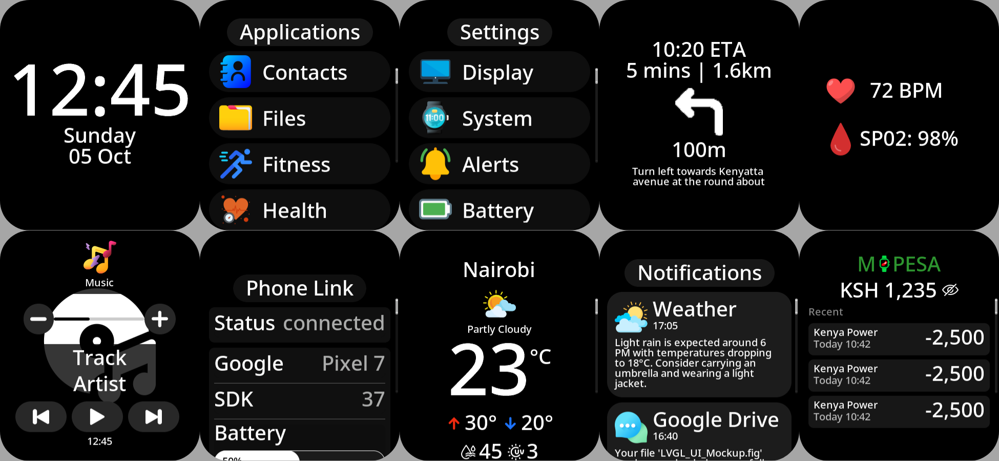

## Watchfaces

Long-press the home screen to switch watchfaces. These previews show the faces enabled by default for each board. [Watchface setup](docs/FIRMWARE.md#watchfaces)

### SiFli LCD DevKit

| 174 | 228 | 1889 | 1891 |
| :---: | :---: | :---: | :---: |
| 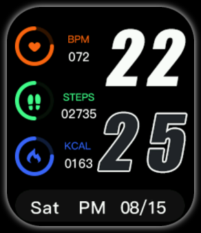 | 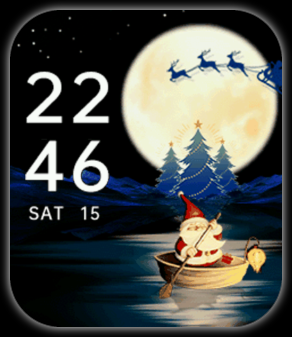 | 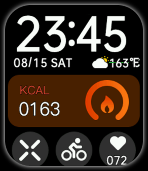 | 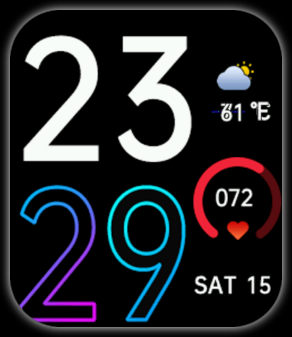 |

### DIY SFWatch v1.0

| 116 | Pixel | 756 | UOE | GTA VI Dark |
| :---: | :---: | :---: | :---: | :---: |
| 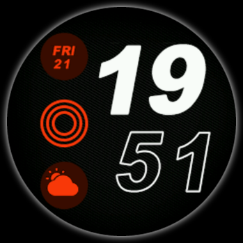 | 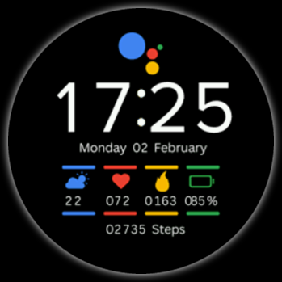 | 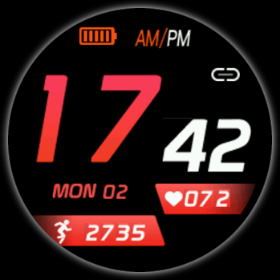 | 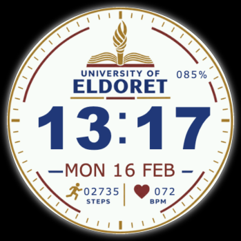 |  |
